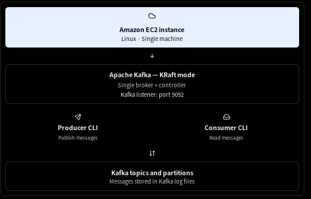

# Setting up Kafka on Single EC2 Instance

You can learn most essential Apache Kafka command-line tools using a single Amazon EC2 instance running Kafka in KRaft mode. This setup is ideal for hands-on practice with topics, producers, consumers, partitions, consumer groups, and offsets—without needing a multi-node Kafka cluster.

## 1. Architecture



Important: A single broker is suitable for learning, not high availability. If the EC2 instance fails, the entire Kafka service becomes unavailable.

## 2. Prepare your EC2 instance

Suggested lab configuration:

- OS: Ubuntu 24.04 LTS or Amazon Linux.
- Instance: 2 vCPUs and 4 GB RAM as a starting point.
- Storage: 20 GB or more for the lab.
- Network: SSH access on port `22`.
- Kafka: A compatible Kafka 4.x release and Java 17 or newer.

Keep Kafka port `9092` private. For a local CLI lab, run the commands directly inside EC2 over SSH; you generally do not need to expose Kafka to the internet.

## 3. Install Java and Kafka

The following commands use Ubuntu on EC2. Kafka 4.x requires Java 17 or newer for the broker. The examples use Kafka `4.3.1`, as listed in the official quickstart.&#x20;


### Step 1 — Connect to EC2

From your local terminal:

```
ssh -i your-key.pem ubuntu@YOUR_EC2_PUBLIC_IP
```

### Step 2 — Install Java and utilities

```
sudo apt update
sudo apt install -y openjdk-21-jdk wget tar

java -version
```

### Step 3 — Download and extract Kafka

```
cd ~
wget https://downloads.apache.org/kafka/4.3.1/kafka_2.13-4.3.1.tgz

tar -xzf kafka_2.13-4.3.1.tgz
cd kafka_2.13-4.3.1
```

If the download URL is unavailable, use the official [Apache Kafka downloads page](https://kafka.apache.org/downloads/?utm_source=chatgpt.com).

### Step 4 — Initialize Kafka in KRaft mode

Run these commands once for this new installation:

```
KAFKA_CLUSTER_ID="$(bin/kafka-storage.sh random-uuid)"

bin/kafka-storage.sh format \
  --standalone \
  -t "$KAFKA_CLUSTER_ID" \
  -c config/server.properties
```

This initializes Kafka's storage metadata. Do not reformat an existing data directory containing messages you want to keep.

### Step 5 — Start Kafka

```
bin/kafka-server-start.sh config/server.properties
```

Keep this terminal session running. Open additional SSH sessions to execute the CLI commands below.

### Lab 5 — Consumer groups

Start a consumer using a named group:

```
bin/kafka-console-consumer.sh \
  --bootstrap-server "$BS" \
  --topic cyber-events \
  --group soc-analysts
```

In another terminal, inspect the group:

```
bin/kafka-consumer-groups.sh \
  --bootstrap-server "$BS" \
  --list
```

Describe its members and progress:

```
bin/kafka-consumer-groups.sh \
  --bootstrap-server "$BS" \
  --describe \
  --group soc-analysts
```

Look at these fields:

| Field            | Meaning                                            |
| ---------------- | -------------------------------------------------- |
| `GROUP`          | Consumer group name                                |
| `TOPIC`          | Topic being consumed                               |
| `PARTITION`      | Partition assigned to a consumer                   |
| `CURRENT-OFFSET` | Consumer group's committed position                |
| `LOG-END-OFFSET` | Current end position of the partition              |
| `LAG`            | Difference between end offset and committed offset |

Exercise: Produce additional messages and observe how the group's offsets and lag change.

### Lab 6 — Inspect and modify topic configurations

View topic configuration:

```
bin/kafka-configs.sh \
  --bootstrap-server "$BS" \
  --entity-type topics \
  --entity-name cyber-events \
  --describe
```

Set message retention to one hour:

```
bin/kafka-configs.sh \
  --bootstrap-server "$BS" \
  --entity-type topics \
  --entity-name cyber-events \
  --alter \
  --add-config retention.ms=3600000
```

Verify the setting by running the describe command again.

This is a useful way to learn how Kafka retention settings affect stored data. Retention is not an immediate deletion guarantee; Kafka removes expired log segments according to its cleanup process.

### Lab 7 — Inspect topic offsets

```
bin/kafka-get-offsets.sh \
  --bootstrap-server "$BS" \
  --topic cyber-events
```

This reports partition offsets, helping you understand how Kafka tracks message positions.

An offset is a position within a particular partition, not a globally unique message number across the entire topic.

### Lab 8 — Produce keyed messages

Keys are useful when you want events for the same entity to be routed consistently to a partition.

Run:

```
bin/kafka-console-producer.sh \
  --bootstrap-server "$BS" \
  --topic cyber-events \
  --property parse.key=true \
  --property key.separator=:
```

Enter:

```
host-01:Failed login
host-02:Malware detected
host-01:Repeated authentication failure
```

Read the records while displaying their keys:

```
bin/kafka-console-consumer.sh \
  --bootstrap-server "$BS" \
  --topic cyber-events \
  --from-beginning \
  --property print.key=true \
  --property key.separator=:
```

Notice that the host identifier is the key and the security event is the value. Messages with the same key are normally routed to the same partition when the default partitioner is used.

### Lab 9 — Delete a topic

Only do this when you no longer need the lab data.

```
bin/kafka-topics.sh \
  --bootstrap-server "$BS" \
  --delete \
  --topic cyber-events
```

Confirm the result:

```
bin/kafka-topics.sh --list --bootstrap-server "$BS"
```

## 6. Kafka CLI reference sheet

| CLI tool                       | Purpose                                    |
| ------------------------------ | ------------------------------------------ |
| `kafka-topics.sh`              | Create, list, describe, and delete topics  |
| `kafka-console-producer.sh`    | Publish messages                           |
| `kafka-console-consumer.sh`    | Read messages                              |
| `kafka-consumer-groups.sh`     | Inspect groups, offsets, and lag           |
| `kafka-configs.sh`             | Inspect and change configurations          |
| `kafka-get-offsets.sh`         | Inspect partition offsets                  |
| `kafka-broker-api-versions.sh` | Check broker connectivity and API versions |
| `kafka-log-dirs.sh`            | Inspect broker log directory information   |
| `kafka-metadata-quorum.sh`     | Inspect KRaft metadata quorum status       |

For the complete set of commands available in your installed version, see the [Apache Kafka documentation](https://kafka.apache.org/documentation/?utm_source=chatgpt.com).