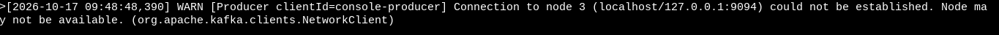

# Multi-broker Kafka setup using Docker Compose

This setup demonstrates how to run a multi-broker Kafka cluster using Docker Compose. It includes multiple Kafka brokers.

- Make sure previous Kafka containers are removed before starting the new setup.
- create a folder `lab04` for the Docker Compose setup.
```bash
mkdir -p lab04
cd lab04
```

- Create a `docker-compose.yml` file inside the `lab04` folder with the necessary Kafka broker configurations. You can refer to the `lab03` setup for guidance on the Kafka broker and Kafka UI configurations.
```bash
nano docker-compose.yml
```
- save and exit the editor.
- start the Kafka cluster using Docker Compose.
```bash
docker compose up -d
```
- Access the UI as in last lab by navigating to [http://<ec2-instance-public-dns>:8080](http://localhost:8080) in your web browser.

- Check the cluster metada using Kafka command line tools

```bash
 docker compose exec kafka1 /opt/kafka/bin/kafka-broker-api-versions.sh --bootstrap-server kafka1:29092
```

- Create a replicated topic

```bash
docker compose exec kafka1 \
  /opt/kafka/bin/kafka-topics.sh \
  --bootstrap-server kafka1:29092 \
  --create \
  --topic orders \
  --partitions 3 \
  --replication-factor 3
```

- Inspect the created topic to verify its configuration.

```bash
docker compose exec kafka1 \
  /opt/kafka/bin/kafka-topics.sh \
  --bootstrap-server kafka1:29092 \
  --describe \
  --topic orders
```

- You should see the topic `orders` with 3 partitions and a replication factor of 3.
- Notice that each partition is replicated across multiple brokers, ensuring high availability and fault tolerance.
- Each partition has 3 replicas but only one of them is the leader for that partition at any given time.
- This setup ensures that even if one broker goes down, the topic remains available through its replicas.
- Produce and Consume messages to and from the `orders` topic.

- Terminal 1: Start a producer
```bash
docker compose exec kafka1 \
  /opt/kafka/bin/kafka-console-producer.sh \
  --bootstrap-server kafka1:9092 \
  --topic orders
```

- Terminal 2: Start a consumer
```bash
docker compose exec kafka2 \
  /opt/kafka/bin/kafka-console-consumer.sh \
  --bootstrap-server kafka2:29092 \
  --topic orders \
  --from-beginning
```

- You can now produce messages in Terminal 1 and see them consumed in Terminal 2, demonstrating the multi-broker Kafka setup in action.
- Verify the replication and leader distribution by describing the topic again after producing some messages.
```bash
docker compose exec kafka1 \
  /opt/kafka/bin/kafka-topics.sh \
  --bootstrap-server kafka1:29092 \
  --describe \
  --topic orders
```

## Test broker failure and leader election
- Inspect Leaders and Replicas

```bash
docker compose exec kafka2 \
  /opt/kafka/bin/kafka-topics.sh \
  --bootstrap-server kafka2:29092 \
  --describe \
  --topic orders
```

- Stop broker 1:
```bash
docker compose stop kafka1
```
Wait a few seconds, then inspect the topic through broker 2:
```bash
docker compose exec kafka2 \
  /opt/kafka/bin/kafka-topics.sh \
  --bootstrap-server kafka2:29092 \
  --describe \
  --topic orders
```

If the topic has healthy in-sync replicas on the remaining brokers, Kafka can elect new leaders for affected partitions. Writes can continue when the required in-sync replica count is satisfied.
Because this setup has three KRaft controllers, the two remaining controllers can maintain a majority of the quorum
- This demonstrates Kafka's ability to handle broker failures and maintain high availability through leader election and replication.

- Restart broker 1:
```bash
docker compose start kafka1
```
- Then inspect the topic again. Leadership may or may not return to the original brokers immediately.
- Important: This is a local learning environment using plaintext listeners, not a production-secured cluster. Also, depends_on alone does not provide readiness checks, and the example has not been executed on your machine; use the logs and verification commands above to confirm the actual result.

## Useful commands

| Task | Command |
| --- | --- |
| View all service logs | `docker compose logs -f` |
| View broker 1 logs | `docker compose logs -f kafka1` |
| List topics | `docker compose exec kafka1 /opt/kafka/bin/kafka-topics.sh --bootstrap-server kafka1:29092 --list` |
| Describe a topic | `docker compose exec kafka1 /opt/kafka/bin/kafka-topics.sh --bootstrap-server kafka1:29092 --describe --topic orders` |
| Stop all services | `docker compose stop` |
| Restart all services | `docker compose start` |
| Stop and remove containers | `docker compose down` |
| Remove containers and all Kafka data | `docker compose down -v` |

Warning: docker compose down -v deletes the three named data volumes and their stored Kafka data.

## Docker-compose 

```yaml
services:
  kafka1:
    image: apache/kafka:4.3.1
    hostname: kafka1
    ports:
      - "9092:9092"
    environment:
      KAFKA_NODE_ID: 1
      KAFKA_PROCESS_ROLES: broker,controller
      KAFKA_LISTENERS: INTERNAL://:29092,CONTROLLER://:29093,EXTERNAL://:9092
      KAFKA_ADVERTISED_LISTENERS: INTERNAL://kafka1:29092,EXTERNAL://localhost:9092
      KAFKA_LISTENER_SECURITY_PROTOCOL_MAP: INTERNAL:PLAINTEXT,CONTROLLER:PLAINTEXT,EXTERNAL:PLAINTEXT
      KAFKA_INTER_BROKER_LISTENER_NAME: INTERNAL
      KAFKA_CONTROLLER_LISTENER_NAMES: CONTROLLER
      KAFKA_CONTROLLER_QUORUM_VOTERS: 1@kafka1:29093,2@kafka2:29093,3@kafka3:29093
      CLUSTER_ID: MkU3OEVBNTcwNTJENDM2Qk
      KAFKA_OFFSETS_TOPIC_REPLICATION_FACTOR: 3
      KAFKA_TRANSACTION_STATE_LOG_REPLICATION_FACTOR: 3
      KAFKA_TRANSACTION_STATE_LOG_MIN_ISR: 2
      KAFKA_DEFAULT_REPLICATION_FACTOR: 3
      KAFKA_MIN_INSYNC_REPLICAS: 2
      KAFKA_LOG_DIRS: /var/lib/kafka/data
    volumes:
      - kafka1-data:/var/lib/kafka/data

  kafka2:
    image: apache/kafka:4.3.1
    hostname: kafka2
    ports:
      - "9093:9093"
    environment:
      KAFKA_NODE_ID: 2
      KAFKA_PROCESS_ROLES: broker,controller
      KAFKA_LISTENERS: INTERNAL://:29092,CONTROLLER://:29093,EXTERNAL://:9093
      KAFKA_ADVERTISED_LISTENERS: INTERNAL://kafka2:29092,EXTERNAL://localhost:9093
      KAFKA_LISTENER_SECURITY_PROTOCOL_MAP: INTERNAL:PLAINTEXT,CONTROLLER:PLAINTEXT,EXTERNAL:PLAINTEXT
      KAFKA_INTER_BROKER_LISTENER_NAME: INTERNAL
      KAFKA_CONTROLLER_LISTENER_NAMES: CONTROLLER
      KAFKA_CONTROLLER_QUORUM_VOTERS: 1@kafka1:29093,2@kafka2:29093,3@kafka3:29093
      CLUSTER_ID: MkU3OEVBNTcwNTJENDM2Qk
      KAFKA_OFFSETS_TOPIC_REPLICATION_FACTOR: 3
      KAFKA_TRANSACTION_STATE_LOG_REPLICATION_FACTOR: 3
      KAFKA_TRANSACTION_STATE_LOG_MIN_ISR: 2
      KAFKA_DEFAULT_REPLICATION_FACTOR: 3
      KAFKA_MIN_INSYNC_REPLICAS: 2
      KAFKA_LOG_DIRS: /var/lib/kafka/data
    volumes:
      - kafka2-data:/var/lib/kafka/data

  kafka3:
    image: apache/kafka:4.3.1
    hostname: kafka3
    ports:
      - "9094:9094"
    environment:
      KAFKA_NODE_ID: 3
      KAFKA_PROCESS_ROLES: broker,controller
      KAFKA_LISTENERS: INTERNAL://:29092,CONTROLLER://:29093,EXTERNAL://:9094
      KAFKA_ADVERTISED_LISTENERS: INTERNAL://kafka3:29092,EXTERNAL://localhost:9094
      KAFKA_LISTENER_SECURITY_PROTOCOL_MAP: INTERNAL:PLAINTEXT,CONTROLLER:PLAINTEXT,EXTERNAL:PLAINTEXT
      KAFKA_INTER_BROKER_LISTENER_NAME: INTERNAL
      KAFKA_CONTROLLER_LISTENER_NAMES: CONTROLLER
      KAFKA_CONTROLLER_QUORUM_VOTERS: 1@kafka1:29093,2@kafka2:29093,3@kafka3:29093
      CLUSTER_ID: MkU3OEVBNTcwNTJENDM2Qk
      KAFKA_OFFSETS_TOPIC_REPLICATION_FACTOR: 3
      KAFKA_TRANSACTION_STATE_LOG_REPLICATION_FACTOR: 3
      KAFKA_TRANSACTION_STATE_LOG_MIN_ISR: 2
      KAFKA_DEFAULT_REPLICATION_FACTOR: 3
      KAFKA_MIN_INSYNC_REPLICAS: 2
      KAFKA_LOG_DIRS: /var/lib/kafka/data
    volumes:
      - kafka3-data:/var/lib/kafka/data

  kafka-ui:
    image: provectuslabs/kafka-ui:latest
    ports:
      - "8080:8080"
    depends_on:
      - kafka1
      - kafka2
      - kafka3
    environment:
      KAFKA_CLUSTERS_0_NAME: local-kafka-cluster
      KAFKA_CLUSTERS_0_BOOTSTRAPSERVERS: kafka1:29092,kafka2:29092,kafka3:29092
      DYNAMIC_CONFIG_ENABLED: "true"

volumes:
  kafka1-data:
  kafka2-data:
  kafka3-data:
```

## Common Error:


It is because of the below command 

```bash
docker compose exec kafka2   /opt/kafka/bin/kafka-console-producer.sh   --bootstrap-server localhost:9093   --topic orders
```

The **correct** command would be

```bash
docker compose exec kafka2   /opt/kafka/bin/kafka-console-producer.sh   --bootstrap-server kafka2:9093   --topic orders
```

If you are using with external then you have to use with `localhost`