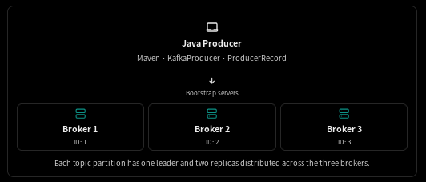

# Kafka Java Producer: Step-by-Step Maven Example with a 3-Broker Cluster and Replication Factor 3

We'll build a working Kafka setup with 3 Kafka brokers, create a topic with replication factor 3, and write a Java producer using Maven to publish messages to that topic.

We'll use Docker Compose for the Kafka cluster and Java with the official Apache Kafka client library for the producer.

## Understand the architecture



Each topic partition has one leader and two replicas distributed across the three brokers.

We'll configure the topic as follows:

| Setting                  | Value           |
| ------------------------ | --------------- |
| Kafka brokers            | 3               |
| Topic                    | `orders`        |
| Partitions               | 3               |
| Replication factor       | 3               |
| Minimum in-sync replicas | 2               |
| Producer acknowledgments | `all`           |
| Producer key             | `orderId`       |
| Producer value           | JSON order data |

## Prerequisites

Install these tools on your machine:

- Java 17 or later
- Maven 3.8+
```bash
sudo dnf install maven -y
```
- Docker Engine and Docker Compose

Check the installations:

```
java -version
mvn -version
docker --version
docker compose version
```

## Create the project structure

Create a Maven project named `kafka-java-producer`.

```bash
mvn archetype:generate \
  -DgroupId=com.example.kafka \
  -DartifactId=kafka-java-producer \
  -DarchetypeArtifactId=maven-archetype-quickstart \
  -DarchetypeVersion=1.5 \
  -DinteractiveMode=false
```

```
mkdir -p kafka-java-producer/src/main/java/com/example/kafka
cd kafka-java-producer
```

Your project will look like this:

```
kafka-java-producer/
├── docker-compose.yml
├── pom.xml
└── src/
    └── main/
        └── java/
            └── com/
                └── example/
                    └── kafka/
                        └── OrderProducer.java
```

We'll create each file below.

## Start the three-broker Kafka cluster

Create `docker-compose.yml` in the project root.

This local development example uses three combined broker/controller nodes in KRaft mode. It keeps the setup compact while giving you three brokers for replication and failure testing. For production, prefer dedicated controllers, persistent storage, and authenticated/encrypted listeners.


### Understand the listeners

| Listener     | Purpose                               | Example           |
| ------------ | ------------------------------------- | ----------------- |
| `INTERNAL`   | Broker-to-broker traffic              | `kafka-1:19092`   |
| `CONTROLLER` | KRaft metadata quorum                 | `kafka-1:9093`    |
| `EXTERNAL`   | Java application running on your host | `localhost:29092` |

Why do we need two client-facing addresses?

A Kafka producer doesn't use only the bootstrap address. It connects to a bootstrap broker, retrieves cluster metadata, and then connects to the broker that leads the target partition.

The `INTERNAL` listener advertises Docker hostnames that other containers can resolve. The `EXTERNAL` listener advertises host ports accessible to your Java application.

### Start Kafka

From the directory containing `docker-compose.yml`, run:

```
docker compose up -d
```

Check the containers:

```
docker compose ps
```

Check startup logs if needed:

```
docker compose logs --tail=100 kafka1
docker compose logs --tail=100 kafka2
docker compose logs --tail=100 kafka3
```

Wait for all three brokers to become ready before creating a topic.

## Create the `orders` topic with replication factor 3

Execute the Kafka topic command inside one of the containers:

```
docker compose exec kafka1 /opt/kafka/bin/kafka-topics.sh \
  --bootstrap-server kafka1:9092,kafka2:9093,kafka3:9094 \
  --create \
  --topic orders \
  --partitions 3 \
  --replication-factor 3 \
  --config min.insync.replicas=2
```

Expected result:

```
Created topic orders.
```

If you see an error that the topic already exists, inspect it instead of trying to create it again.

### Verify the topic configuration

```
docker compose exec kafka1 /opt/kafka/bin/kafka-topics.sh \
  --bootstrap-server kafka1:9092,kafka2:9093,kafka3:9094 \
  --describe \
  --topic orders
```

You should see output similar to:

```
Topic: orders  PartitionCount: 3  ReplicationFactor: 3

Topic: orders  Partition: 0  Leader: 1  Replicas: 1,2,3  Isr: 1,2,3
Topic: orders  Partition: 1  Leader: 2  Replicas: 2,3,1  Isr: 2,3,1
Topic: orders  Partition: 2  Leader: 3  Replicas: 3,1,2  Isr: 3,1,2
```

The actual leader and replica order may differ.

## Create the Maven `pom.xml`

Add this to `pom.xml`.

We'll use `kafka-clients` for the producer API and the Maven Shade plugin to package the application and its dependencies into a runnable JAR. The official Kafka client library is published under `org.apache.kafka:kafka-clients`.&#x20;

```xml
  <properties>
    <project.build.sourceEncoding>UTF-8</project.build.sourceEncoding>
    <maven.compiler.release>17</maven.compiler.release>
    <kafka.clients.version>4.3.1</kafka.clients.version>
    <junit.jupiter.version>5.11.4</junit.jupiter.version>
  </properties>

<dependencies>
    <dependency>
      <groupId>org.apache.kafka</groupId>
      <artifactId>kafka-clients</artifactId>
      <version>${kafka.clients.version}</version>
    </dependency>

    <dependency>
      <groupId>org.slf4j</groupId>
      <artifactId>slf4j-simple</artifactId>
      <version>2.0.16</version>
      <scope>runtime</scope>
    </dependency>

    <dependency>
      <groupId>org.junit.jupiter</groupId>
      <artifactId>junit-jupiter</artifactId>
      <version>${junit.jupiter.version}</version>
      <scope>test</scope>
    </dependency>
  </dependencies>

  <build>
    <plugins>
      <plugin>
        <groupId>org.apache.maven.plugins</groupId>
        <artifactId>maven-compiler-plugin</artifactId>
        <version>3.13.0</version>
        <configuration>
          <release>${maven.compiler.release}</release>
        </configuration>
      </plugin>

      <plugin>
        <groupId>org.apache.maven.plugins</groupId>
        <artifactId>maven-surefire-plugin</artifactId>
        <version>3.5.2</version>
        <configuration>
          <useModulePath>false</useModulePath>
        </configuration>
      </plugin>

      <plugin>
        <groupId>org.codehaus.mojo</groupId>
        <artifactId>exec-maven-plugin</artifactId>
        <version>3.5.0</version>
      </plugin>
    </plugins>
  </build>
```

This pins the client to version `4.0.2` so the learning example uses a consistent Kafka version. You can choose another compatible client version if your actual cluster runs a different release.

## 7. Write the Java producer

Create:

`src/main/java/com/example/kafka/OrderProducer.java`

```
package com.example.kafka;

import org.apache.kafka.clients.producer.KafkaProducer;
import org.apache.kafka.clients.producer.ProducerRecord;
import org.apache.kafka.clients.producer.RecordMetadata;
import org.apache.kafka.common.header.internals.RecordHeader;

import java.nio.charset.StandardCharsets;
import java.util.Properties;
import java.util.concurrent.Future;

public class OrderProducer {

    public static void main(String[] args) throws Exception {

        String topic = "orders";

        // Step 1: Configure the producer
        Properties props = new Properties();

        props.put(
            "bootstrap.servers",
            "localhost:9092,localhost:9093,localhost:9094"
        );

        props.put(
            "key.serializer",
            "org.apache.kafka.common.serialization.StringSerializer"
        );

        props.put(
            "value.serializer",
            "org.apache.kafka.common.serialization.StringSerializer"
        );

        // Wait for all currently in-sync replicas to acknowledge
        props.put("acks", "all");

        // Retry transient failures
        props.put("retries", Integer.MAX_VALUE);

        // Preserve order for records sent to a partition
        props.put("enable.idempotence", true);

        // Step 2: Create the producer
        try (KafkaProducer<String, String> producer =
                 new KafkaProducer<>(props)) {

            for (int i = 1; i <= 10; i++) {

                String orderId = "ORD-" + i;

                String orderJson = """
                    {
                      "orderId": "%s",
                      "product": "Laptop",
                      "quantity": 1,
                      "amount": 75000
                    }
                    """.formatted(orderId);

                // Step 3: Build the record
                ProducerRecord<String, String> record =
                    new ProducerRecord<>(
                        topic,
                        null,       // Let Kafka choose the partition
                        orderId,    // Record key
                        orderJson   // Record value
                    );

                // Step 4: Add a header
                record.headers().add(
                    new RecordHeader(
                        "event-type",
                        "ORDER_CREATED".getBytes(StandardCharsets.UTF_8)
                    )
                );

                // Step 5: Send asynchronously and inspect the result
                Future<RecordMetadata> future = producer.send(
                    record,
                    (metadata, exception) -> {
                        if (exception != null) {
                            System.err.println(
                                "Failed to send " + orderId
                                    + ": " + exception.getMessage()
                            );
                        } else {
                            System.out.printf(
                                "Sent key=%s topic=%s partition=%d offset=%d%n",
                                orderId,
                                metadata.topic(),
                                metadata.partition(),
                                metadata.offset()
                            );
                        }
                    }
                );
            }

            // Step 6: Flush outstanding records before closing
            producer.flush();
        }

        System.out.println("Producer finished.");
    }
}

```

### What each part does

Step 1 — Producer configuration

`bootstrap.servers` contains all three broker addresses. The producer can bootstrap through any reachable broker and discover the rest of the cluster.

The serializers convert Java strings into bytes before Kafka sends the records.

Step 2 — Create the producer

`KafkaProducer<String, String>` means the key and value are both Java strings. The producer is thread-safe and can be reused for multiple records.

Step 3 — Create a `ProducerRecord`

The constructor arguments are:

```
new ProducerRecord<>(
    topic,
    partition,
    key,
    value
);
```

In our example:

- Topic: `orders`
- Partition: `null`, so Kafka chooses one
- Key: `ORD-1`, `ORD-2`, and so on
- Value: JSON order data

Step 4 — Add headers

Headers carry extra metadata without requiring consumers to parse it out of the value. Here, `event-type` identifies the event as `ORDER_CREATED`.

Step 5 — Send the message

`producer.send()` is asynchronous. It returns a `Future`, and the callback executes when Kafka reports success or failure.

The callback prints the topic, partition, and offset. The offset identifies the record's position within that partition.

Step 6 — Flush and close

`flush()` waits for outstanding sends to complete. The try-with-resources block closes the producer and releases its resources.

One small detail: the returned `Future` isn't otherwise used in this example. The callback provides the send result, and `flush()` ensures outstanding records are handled before the producer closes.

## 8. Build and run the producer

From the project root, compile and package the application:

```
mvn clean package
```

If the build succeeds, Maven creates a shaded JAR under `target/`.

Run it:

```
java -jar target/kafka-java-producer-1.0-SNAPSHOT.jar
```

You should see output similar to:

```
Sent key=ORD-1 topic=orders partition=0 offset=0
Sent key=ORD-2 topic=orders partition=1 offset=0
Sent key=ORD-3 topic=orders partition=2 offset=0
Sent key=ORD-4 topic=orders partition=0 offset=1
...
Producer finished.
```

These partition numbers and offsets are illustrative; actual values depend on the state of your topic and the partitioner.

## 9. Verify that Kafka received the messages

Open a new terminal and start a console consumer:

```
docker compose exec kafka-1 /opt/kafka/bin/kafka-console-consumer.sh \
  --bootstrap-server kafka-1:19092,kafka-2:19092,kafka-3:19092 \
  --topic orders \
  --from-beginning
```

You should see the JSON order records printed.

The console consumer above reads from the beginning of the topic, so if you run it again, it can display the existing records again.

To inspect message keys, partitions, and offsets, use:

```
docker compose exec kafka-1 /opt/kafka/bin/kafka-console-consumer.sh \
  --bootstrap-server kafka-1:19092,kafka-2:19092,kafka-3:19092 \
  --topic orders \
  --from-beginning \
  --property print.key=true \
  --property print.partition=true \
  --property print.offset=true
```

This makes it easier to see how the producer's records are distributed across partitions.

## 10. How replication factor 3 works with this producer

Consider an order record sent to `orders-0`.

Java producer

Sends the order record

Partition leader

Broker 1 — `orders-0`

Receives and appends the record

Broker 2

Follower replica

Broker 3

Follower replica

With `acks=all`, the write is acknowledged after all replicas currently in the in-sync replica set have acknowledged it, subject to Kafka's producer and broker behavior.

The important producer settings are:

```
props.put("acks", "all");
props.put("enable.idempotence", true);
```

And the topic configuration is:

```
replication factor = 3
min.insync.replicas = 2
```

These settings work together:

| Situation                                            | Expected result                                                                                                    |
| ---------------------------------------------------- | ------------------------------------------------------------------------------------------------------------------ |
| All three replicas are in sync                       | Writes can succeed with all three acknowledging                                                                    |
| One broker goes down and two replicas remain in sync | Writes can continue                                                                                                |
| Only one replica remains in sync                     | Writes with `acks=all` fail because the minimum ISR is 2                                                           |
| A transient request fails                            | The producer can retry; idempotence protects against duplicate writes caused by retries within its supported scope |

Replication and idempotence improve reliability, but they do not make every possible application-level failure exactly-once. For example, a producer restart and application-level resubmission can still result in duplicate business events unless the application handles them appropriately.

## 11. Test broker failure

This is a useful exercise to verify that your replication configuration is working.

First, stop broker 1:

```
docker compose stop kafka-1
```

Check the topic again through broker 2:

```
docker compose exec kafka-2 /opt/kafka/bin/kafka-topics.sh \
  --bootstrap-server kafka-2:19092,kafka-3:19092 \
  --describe \
  --topic orders
```

If the cluster has elected replacement leaders and the remaining replicas are in sync, the topic can continue operating for partitions whose availability requirements are satisfied.

Now try running your Java producer again. Because the bootstrap list includes all three addresses, it can initially connect through broker 2 or broker 3 if broker 1 is unavailable.

Important: `localhost:29092` is the host port for broker 1. The client must be able to connect to at least one reachable bootstrap broker, and the broker metadata must advertise addresses accessible to that client. In this example, the advertised host addresses are intended for a Java application running directly on your machine.

Restore broker 1 afterward:

```
docker compose start kafka-1
```

Wait for it to rejoin the cluster and for its replicas to catch up.

## 12. Common problems

| Error or symptom                        | What to check                                                               |
| --------------------------------------- | --------------------------------------------------------------------------- |
| `Connection refused`                    | Ensure all containers are running and the host ports are available          |
| `UnknownHostException: kafka-1` in Java | Use the external bootstrap addresses when running Java on the host          |
| `LEADER_NOT_AVAILABLE`                  | Wait for startup or partition leader election                               |
| `NOT_ENOUGH_REPLICAS`                   | Check broker health, ISR membership, and `min.insync.replicas`              |
| Topic already exists                    | Run `--describe` instead of creating it again                               |
| Maven compilation failure               | Check Java and Maven versions and the compiler output                       |
| Messages aren't visible                 | Confirm the topic name and use the console consumer with `--from-beginning` |

## 13. Clean up

Stop the cluster:

```
docker compose down
```

This removes the containers and default network. Since this example doesn't configure persistent volumes, its Kafka data is not intended to survive container recreation.

## Final recap

You now have a complete learning workflow:

1. Start a three-broker Kafka cluster.
2. Create the `orders` topic with three partitions and replication factor 3.
3. Build a Java producer with Maven.
4. Publish keyed JSON messages with headers.
5. Verify the records using a console consumer.
6. Test how replication and leader failover affect producer writes.

The next useful extension would be to add JSON serialization with Jackson, a custom partitioner, batching and compression, and a Java consumer so you can observe how producer settings affect throughput and delivery behavior.